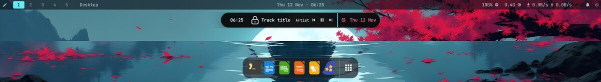

# AetherOS Dotfiles

**A macOS-inspired, GPU-aware Hyprland desktop for Fedora** — by **Neelampalli Charan Balaji**.

[](LICENSE)
[](INSTALL.md)
[](docs/HYPRLAND_GUIDE.md)

⭐ **If you like it, please star [the repository](https://github.com/charanbalaji2005/Aether-dotfiles)** — it helps others find it.



Two interfaces:

- **classic** (default) — Waybar top bar, **Dynamic Island** music player, **macOS-style dock**,
  Rofi **launchpad** and menus (Wi-Fi, Bluetooth, audio, clipboard, emoji, calculator, settings),
  SwayNC, Wlogout, Hyprlock/Hypridle, swww and wallust: wallpaper-based colours for every app,
  14 bar layouts, 11 styles and one-step **looks** (Super+Ctrl+L).
  Guide: [docs/CLASSIC_INTERFACE.md](docs/CLASSIC_INTERFACE.md).
- **aether** — an original Quickshell/QML shell with its own animation and graphics engine, a
  hardware-aware backend and an optional local-first assistant.

## Install (Fedora 41+)

```sh
git clone -b release-final https://github.com/charanbalaji2005/Aether-dotfiles ~/Aether-dotfiles
cd ~/Aether-dotfiles && ./install.sh
```

The **onboarding installer** shows your system (CPU, GPUs and drivers, memory, display, Hyprland
and Waybar versions), lets you pick components — *Recommended*, *Select all*, *Custom* — asks
every question up front, then installs with **live progress** (download percentage, speed and
size), validates everything and writes a report. Your current configuration is **backed up and
never overwritten**; your keybinds, scripts and wallpapers are kept. Undo with `./restore.sh`.

```sh
./install.sh --dry-run                                   # preview, changes nothing
./install.sh --install --components hyprland,waybar,rofi # without menus
./update.sh                                              # pull + re-link + validate
./restore.sh                                             # put your old configuration back
```

Full guide: **[INSTALL.md](INSTALL.md)**. After login: `SUPER + H` lists every key.

## What you get

| | |
|---|---|
| **Desktop** | top bar, Dynamic Island (art, title, waveform, seekable progress), magnifying dock, launchpad, control and notification centre, power menu, lock screens, 22 wallpapers with a gallery |
| **Look** | colours from your wallpaper for every app, 18 palettes, glass presets, original GLSL shaders with fallbacks, physics springs, motion profiles |
| **GPU** | NVML telemetry without waking a sleeping hybrid dGPU, quality tiers chosen from hardware, power and frame pacing — with the reasons shown |
| **System** | keyboard, touchpad, displays with auto-revert, startup apps, power profiles, idle dim/lock/suspend, updates, user services |
| **Safety** | backups and a moved-aside manifest, snapshots with checksums, last-known-good, safe-mode shell, one-command recovery, audit log, secret redaction |

Settings — [docs/SETTINGS.md](docs/SETTINGS.md) · Keys — [docs/KEYBINDS.md](docs/KEYBINDS.md) ·
CLI — [docs/CLI_REFERENCE.md](docs/CLI_REFERENCE.md).

## Status

**1.0.0.** Covered by automated tests (installer and onboarding end to end, configs, QML
structure, Quickshell API conformance against 0.2.0–0.3.2, a real RPM build), and used daily on
Fedora 44 with Hyprland 0.57. Not yet confirmed on other hardware: PAM unlock in the aether
shell, the NVIDIA proprietary driver, suspend/resume and multi-monitor — the checklist is in
[docs/HARDWARE.md](docs/HARDWARE.md). Third-party widgets are off by default and not sandboxed
([SECURITY.md](SECURITY.md)). Keep a TTY (Ctrl+Alt+F3) handy for the first login and read
[RECOVERY.md](RECOVERY.md).

## Documentation

[INSTALL](INSTALL.md) · [RECOVERY](RECOVERY.md) · [HARDWARE](docs/HARDWARE.md) ·
[GPU optimisation](docs/GPU_OPTIMIZATION.md) · [Settings](docs/SETTINGS.md) ·
[Customization](docs/CUSTOMIZATION.md) · [Assistant](docs/AI_ASSISTANT.md) ·
[Automation](docs/AUTOMATION.md) · [Widgets](docs/WIDGETS.md) · [CLI](docs/CLI_REFERENCE.md) ·
[Keybinds](docs/KEYBINDS.md) · [Troubleshooting](docs/TROUBLESHOOTING.md) ·
[NVIDIA](docs/NVIDIA_GUIDE.md) · [Drivers](docs/DRIVER_GUIDE.md) · [Hyprland](docs/HYPRLAND_GUIDE.md) ·
[Architecture](ARCHITECTURE.md) · [Testing](docs/TESTING.md) · [Test report](TEST_REPORT.md) ·
[Changelog](CHANGELOG.md) · [Security](SECURITY.md) · [Contributing](CONTRIBUTING.md) ·
[Code of conduct](CODE_OF_CONDUCT.md)

## Support

- ⭐ Star the repository: <https://github.com/charanbalaji2005/Aether-dotfiles>
- 🐞 Bugs and ideas: [issues](https://github.com/charanbalaji2005/Aether-dotfiles/issues) —
  attach `aether diagnostics` and the installation report from `~/.local/state/aether/reports/`.
- 📣 Share it with people who love a beautiful desktop.

## License

Copyright (C) 2026 **Neelampalli Charan Balaji**. Free software under the GNU General Public
License, version 3 or later — see [LICENSE](./LICENSE). Third-party attributions in
[THIRD_PARTY.md](./THIRD_PARTY.md).
