# The classic interface

AetherOS ships two interfaces on top of the same Hyprland configuration:

| | **classic** (default) | **aether** |
|---|---|---|
| Bar | Waybar | Quickshell panel |
| Launcher and menus | Rofi | Quickshell launcher, control centre |
| Notifications | SwayNC | built into the shell |
| Power menu | Wlogout (Rofi fallback) | built into the shell |
| Lock / idle | Hyprlock / Hypridle | shell lock screen / generated hypridle |
| Wallpaper | swww (+ mpvpaper for video) | shell wallpaper engine |
| Colours | `aether-colors` (wallust or built-in) | shell palettes |

The classic interface uses the same family of tools as other well-known Hyprland
setups (JaKooLit and similar); every configuration file, script, style and icon here is
written for AetherOS.

```sh
aether-interface status                 # which one is active
aether-interface set classic            # switch now (inside Hyprland) or at next login
aether-interface set aether
aether-interface doctor                 # what's installed, what's missing, what each costs
```

`set` writes `~/.config/aether-shell/interface`, the Hyprland fragments
`~/.config/aether-shell/hypr/interface.conf` (autostart + keys) and `interface-theme.conf`
(border colours), enables/disables the matching systemd user units, and — inside a session —
stops the old interface and starts the new one.

## Looks

A look switches the whole appearance at once — bar layout, bar style, launcher, palette, and
window gaps/borders/rounding — without touching your wallpaper or keys:
**`SUPER + CTRL + L`**, Super+A → Look, or `aether-look apply NAME`. Each part can still be
changed alone afterwards. Looks are rows in `config/aether-looks.tsv`; add your own there.

A new install starts with **anime** (Anime Dream). The six identity looks:

| Look | Bar | Launcher | Palette | Lock screen |
|---|---|---|---|---|
| `anime` | soft glass capsules with dusk gradients | sidebar | from wallpaper | anime — huge split clock, low left |
| `cyber` | black bar with a glowing neon edge, square segments | terminal strip | neon | cyber — neon readouts |
| `glass` | frosted capsules | icon grid | slate | glass — clock in a frosted panel |
| `emerald` | teal blocks | side panel | emerald | typography — stacked hours/minutes |
| `retrowave` | two bars, purple and pink | icon grid | dusk | retro — alarm-clock time |
| `devpro` | dense meters and network speed | terminal strip | graphite | minimal |

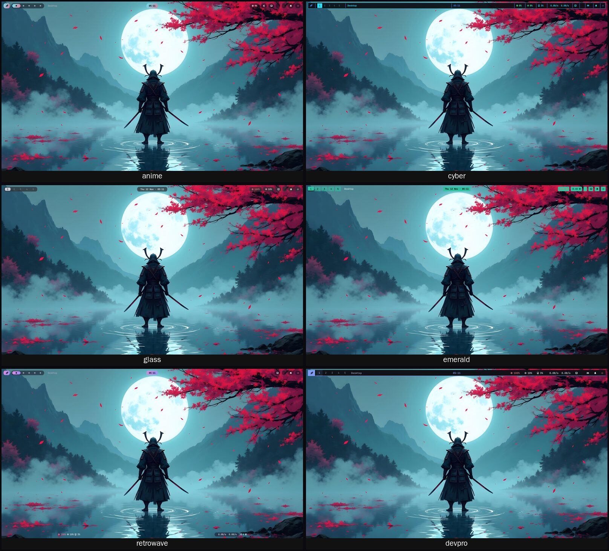

The layout looks:

| Look | Bar | Launcher | Palette |
|---|---|---|---|
| `default` | floating capsules | sidebar | from wallpaper |
| `lofi` | thin dark full-width bar, centred date, dot workspaces | sidebar | from wallpaper |
| `frost` | frosted grey capsules, boxed workspace numbers | icon grid | slate |
| `desk` | slim menu bar + bottom dock with launchers and open windows | side panel | from wallpaper |
| `orbit` | no bar: floating workspace pill + mini dock pill | icon grid | from wallpaper |
| `retro` | one dense line of coloured readings with thin dividers | terminal strip | synth |
| `pixel` | compact icon strip; fastfetch with your wallpaper on `SUPER + F12` | terminal strip | from wallpaper |
| `blocks` | square solid accent blocks, boxed numbered workspaces | sidebar | lagoon (teal) |

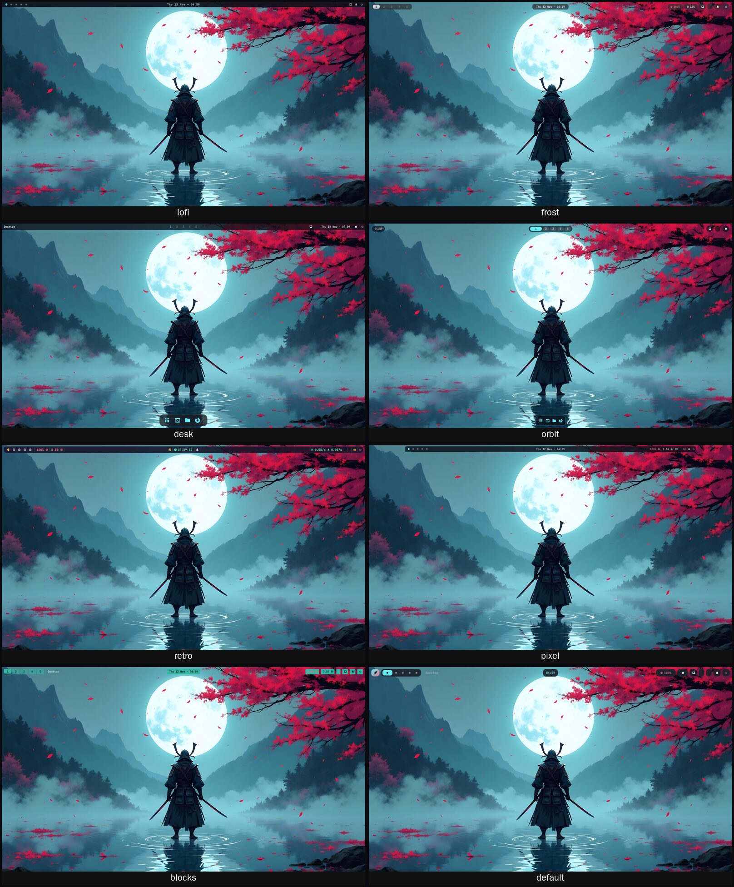

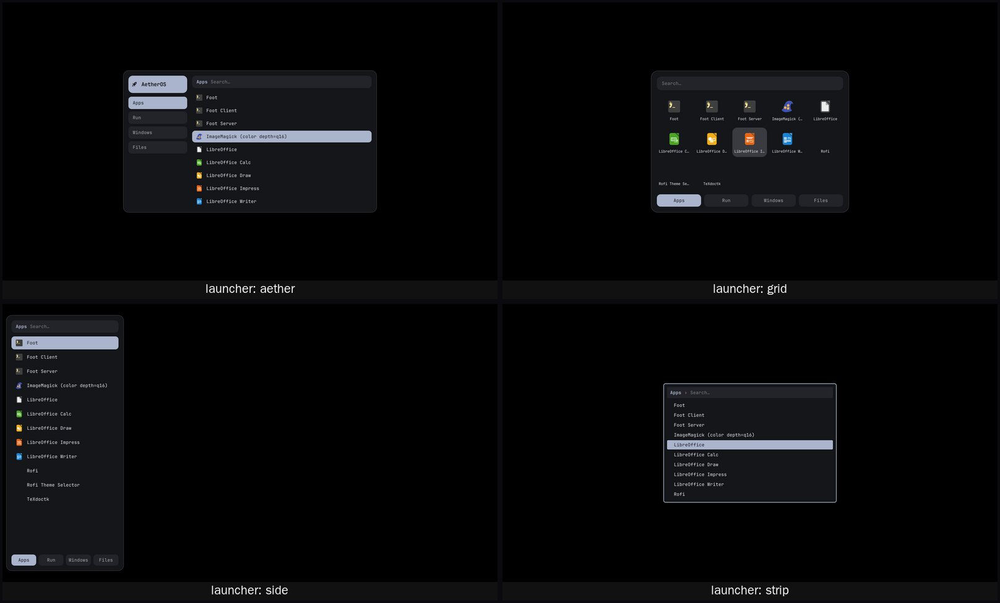

The previews were rendered by real Waybar 0.10 on a headless Wayland compositor (Sway, so
workspace buttons use Sway's module) and real Rofi 1.7.5; empty capsules are modules with no
data in that sandbox (no audio server, battery or Bluetooth).

## Home: island, dock and Launchpad

The **home** look (the default for new installs) has three bars: a thin top bar, a centred
**island** and a **dock**.

- **Island** — sizes itself to what is happening, no hovering needed: a small time pill when
  idle; while music plays a card with rounded album art, title and artist over previous /
  play-pause / next, and two lines of upcoming events on the right (khal or calcurse, or the
  date and time when no calendar is set up); on volume/brightness keys a level bar for ~2 s.
  Event-driven (`playerctl --follow`, and `aether-osd` signals it), never polled; it never
  shows a track when nothing is playing. Options in Settings → Island.

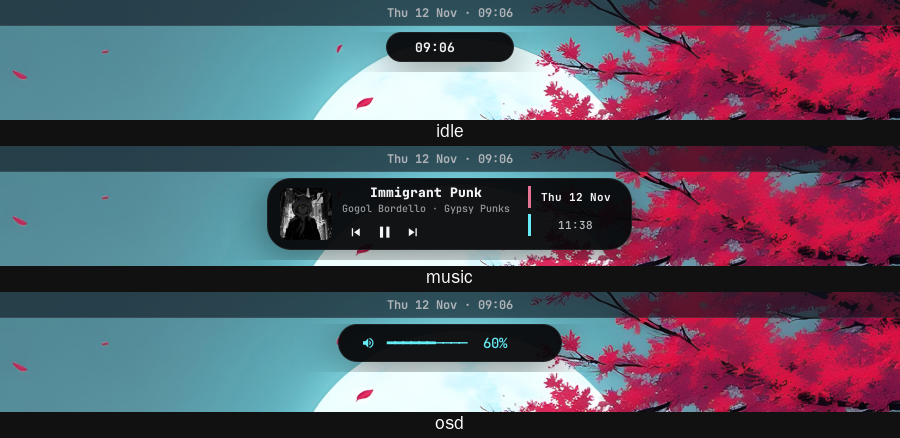
- **Dock** — pinned apps with their real icons from your icon theme; a click runs
  `gtk-launch`. The grid button opens **Launchpad** (`SUPER + ALT + D`), a full-screen app grid
  that Hyprland pops in with a scale animation; right-click it to customise the dock:
  `aether-dock add ID | remove ID | move ID left|right | size PX | apps | list`.

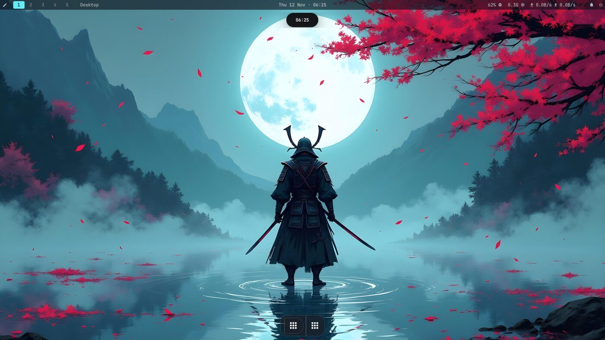

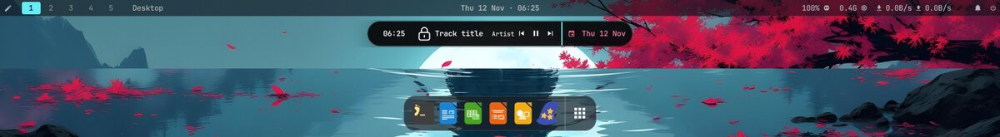

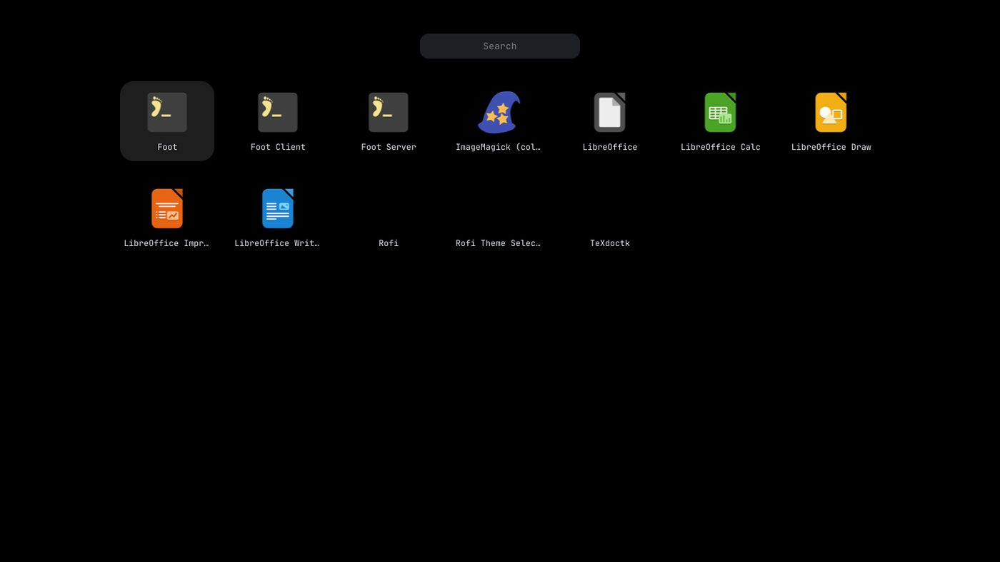

Because it is a Waybar bar, the island changes size instantly rather than with a morphing
animation; the aether (Quickshell) interface has the spring-animated Dynamic Island.

## Control Centre

`SUPER + A` (or the bar's 󰒓 button) opens a frosted-glass panel in the top-right corner:
date and time, Wi-Fi, Bluetooth, airplane mode, now playing, Do Not Disturb, night light,
dark mode, display and sound sliders, power profile, screenshot, recording, lock and
settings. Every tile reads the real state (refreshed every 2 s while open) and acts through
the same helpers as the keys; tiles whose program isn't installed are dimmed and say so.
It is a layer-shell surface (namespace `aether-control`) so Hyprland blurs behind it; it
needs `gtk-layer-shell` (Fedora package `gtk-layer-shell`), otherwise it opens as a floating
window. **Edit Controls** opens Settings → Control Centre: a gallery of all 22 controls by
category with Add / Remove / ↑ ↓, and a live preview of the panel. The layout is saved in
`~/.config/aether-shell/classic/control-centre.json`. Super+Ctrl+A keeps the Rofi menu.

Laid out like a phone control centre: a connectivity card (airplane, power profile, Wi-Fi,
Bluetooth), the player with album art, round toggles that light up in their own colour,
tall brightness/volume sliders that fill from the bottom (drag, click or scroll), the Focus
pill and a row of round buttons; **+** (top left) opens the editor, ⏻ the power menu.

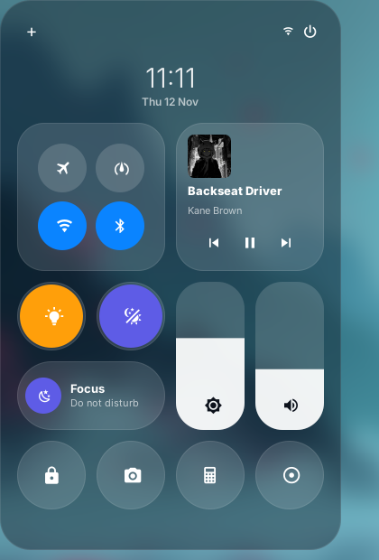

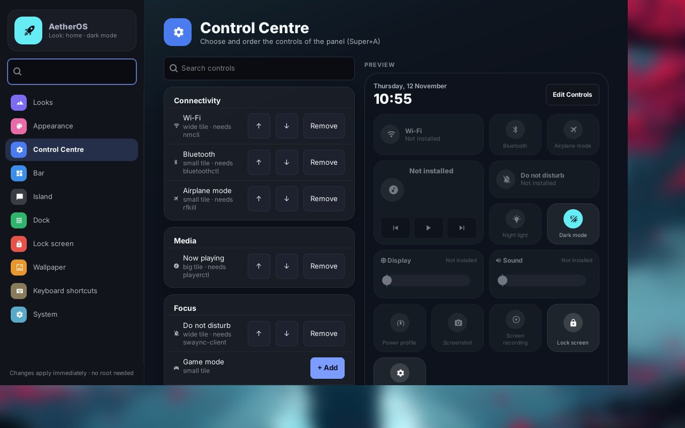

## Frosted glass (default)

`aether-glass off | subtle | acrylic | deep` (Settings → Appearance → Frosted glass).
**acrylic** is the default: Hyprland blur (size 10, 3 passes) behind every translucent
surface, **every app window** at 90% opacity when focused and 84% when not, kitty with a 72%
background (its text stays fully sharp), and matching translucency for Rofi, SwayNC, the
bar, the Control Centre and Settings. Only video players and games stay opaque. The visual profile still wins: `aether
performance hyprland battery` turns blur off.

## Settings window

`SUPER + CTRL + S` (or Super+A → Open the Settings window) opens **AetherOS Settings**, a GTK 3
window with nine pages: Looks, Appearance, Bar, Island, Dock, Lock screen, Wallpaper,
Keyboard shortcuts and System. Every control runs the same helper as the menus and keys
(`aether-look`, `aether-colors`, `aether-waybar`, `aether-dock`, `aether-lock`, `aether-wall`,
`aether-bindings`, `aether-interface`), shows the helper's real result in the status line, and
each page reads the current state when it opens. Without GTK for Python
(`python3-gobject gtk3`) it falls back to the Rofi settings menu.

The window has a profile header, a searchable sidebar with a coloured tile per page, grouped
settings cards, colour previews on every look, and results shown as a toast.

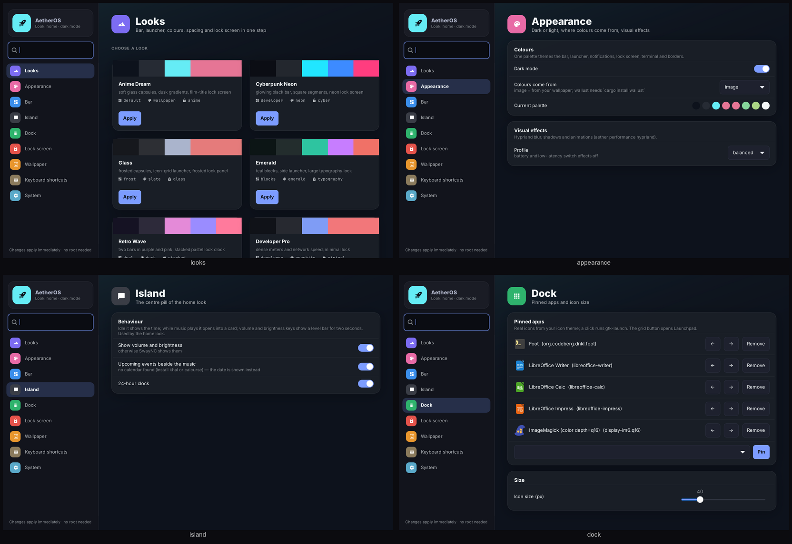

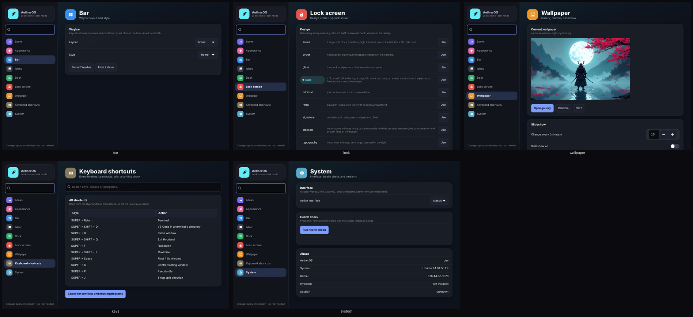

## Lock screen designs

`aether-lock designs` lists them, `aether-lock design NAME` or Super+A → Lock screen design
picks one (each look also sets one), `aether-lock try` locks now to look at it. Designs:
signature, anime, minimal, typography, cyber, glass, retro, stacked (big pastel hours over
minutes with the seconds between), island (a "Locked" pill, thin clock, avatar circle, real
network/volume/battery icons) (`config/hypr/hyprlock/`).
Unlocking is always Hyprlock's PAM password check, whatever the design.

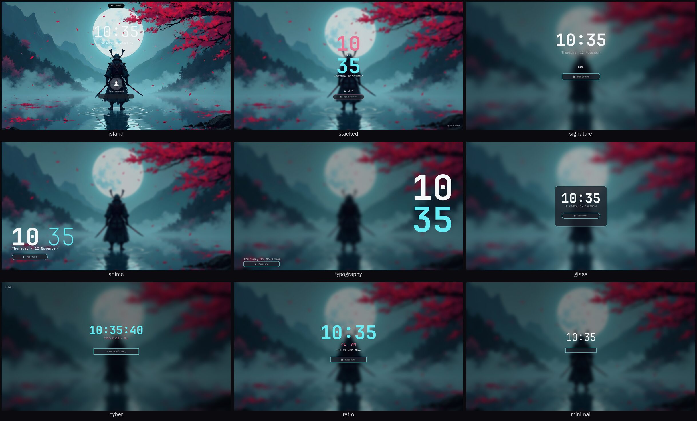

`tools/preview-lockscreen.py DESIGN out.png` draws an approximate preview of a design from
the same config files Hyprlock reads (fonts, colours, positions, wallpaper) — handy for
editing a design without locking your screen. `aether-lock try` shows the real thing.

## Wallpaper gallery

`SUPER + W`: large previews, ★ favourites first (Alt+V), then recently used, then the rest;
sub-folders of `~/Pictures/Wallpapers` are categories (Alt+C); Alt+P starts/stops the
slideshow. Previews are cached in `~/.cache/aether/thumbs`.

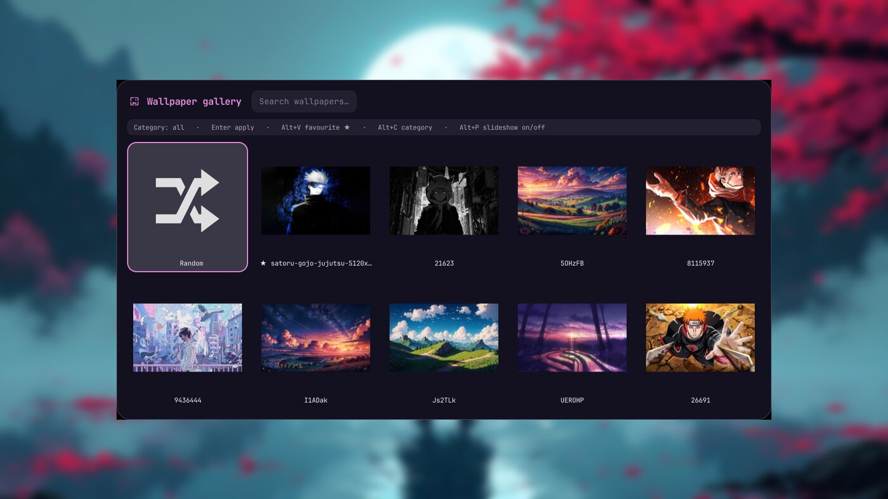

## Keybindings tool and visual profile

`aether-bindings list|search TEXT|check` reads the Hyprland files themselves (descriptions
from `#: …`, categories from section headers) and checks for conflicting keys, unknown
dispatchers and programs that aren't installed; your own keys can go in
`~/.config/aether-shell/hypr/user-binds.conf`. `SUPER + CTRL + P` picks the Hyprland visual
profile (quality, balanced, low-latency, battery) — the existing `aether performance hyprland`.

## What runs

`aether-classic-start` (from `config/hypr/interfaces/classic.conf`) starts, once each and only
if installed: Waybar, SwayNC, the wallpaper daemon (restoring your wallpapers), clipboard
history, Hypridle, nm-applet, blueman-applet (only with a Bluetooth adapter), Pyprland and a
polkit agent. A missing program is logged and skipped, never fatal.
Log: `$XDG_RUNTIME_DIR/aether-classic-$UID/start.log`. Reload everything: `SUPER + CTRL + R`.

## Files

| Path (linked into `~/.config`) | What |
|---|---|
| `config/waybar/modules.jsonc` | every Waybar module, shared by all layouts |
| `config/waybar/layouts/*.jsonc` | default, minimal, compact, developer, laptop, bottom, dual, lofi, frost, desk, orbit, retro, pixel, blocks |
| `config/waybar/styles/*.css` | pills, solid, glass, minimal, lofi, frost, desk, orbit, retro, pixel, blocks (`_base.css` is shared) |
| `config/aether-looks.tsv` | the looks |
| `config/rofi/` | `config.rasi`, `themes/` (launcher, menu, settings, keys, wallpaper grid) |
| `config/swaync/` | `config.json` (control centre widgets and buttons), `style.css` |
| `config/wlogout/` | `layout`, `style.css`, `icons/` |
| `config/hypr/hyprlock.conf`, `hypridle.conf`, `pyprland.toml` | lock screen, idle, scratchpads |
| `config/hypr/interfaces/classic.conf` | autostart and keybinds of the classic interface |
| `config/wallust/` | wallust config + the one template aether-colors reads |
| `scripts/bin/aether-*` | the helpers below |

Generated files never go into the repository: they live in `~/.config/aether-shell/classic/`
(`state.conf`, `colors/`, and the small `style.css` wrappers that import the palette and your
chosen style).

## Helpers

| Command | Purpose |
|---|---|
| `aether-menu …` | apps, run, window, files, clipboard, emoji, calc, web, keys, wifi, bluetooth, audio, theme, waybar, screenshot, power, settings |
| `aether-wall …` | select (previews), set, random, next, prev, restore, slideshow, resize, list |
| `aether-colors …` | apply, mode dark/light/toggle, source wallust/image/preset, presets |
| `aether-waybar …` | start, restart, toggle, layout NAME, style NAME |
| `aether-osd …` | volume / mic / brightness / keyboard backlight with an on-screen level |
| `aether-shot …` | screen, area, window, focused; `--delay N`, `--edit` (swappy) |
| `aether-toggle …` | nightlight, gamemode, dnd, idle (keep awake), airplane |
| `aether-powermenu` | wlogout sized to the focused monitor; `run lock|logout|suspend|…` |
| `aether-weather` | Waybar weather module (opt-in, see below) |
| `aether-look …` | menu, apply NAME, list, current |
| `aether-lock …` | lock now, design NAME, designs, menu, try |
| `aether-bindings …` | list, search, check |
| `aether-fetch` | fastfetch with your wallpaper as the picture (kitty) |

## Colours

One palette themes Waybar, Rofi, SwayNC, Wlogout, Hyprlock, kitty, Hyprland borders and the
GTK dark/light preference. Sources, in order of preference:

1. **wallust** (`aether-colors source wallust`) — if installed (`cargo install wallust`).
2. **built-in** (`aether-colors source image`, the default) — ImageMagick histogram of the wallpaper.
3. **presets** (`aether-colors source preset NAME`) — graphite, abyss, ember, moss (dark), dawn, paper (light).

If a source fails, the next one is used and the reason is printed, so the desktop always gets
valid colours. Text contrast is enforced (≥ 7:1 for text, ≥ 3:1 for accents).

## Customising

- **Layout / style:** `SUPER + CTRL + B`, or `aether-waybar layout laptop`. Add your own file to
  `config/waybar/layouts/` or `styles/` and it appears in the menu.
- **Keys:** edit `config/hypr/interfaces/classic.conf`; add `#: description` after a bind to show
  it in `SUPER + H`.
- **Wallpaper folders:** `~/Pictures/Wallpapers` and the bundled set; more with
  the key `wall_dirs` (colon-separated) in `~/.config/aether-shell/classic/state.conf`.
- **Weather** sends your approximate location to wttr.in, so it is **off** until you set a place:
  add `weather_location=Berlin` (or `weather=on` for automatic) to `state.conf`.
- **Search engine:** `search_url=https://www.startpage.com/do/search?q=` and `search_name=Startpage`.
- **Night light temperature:** `nightlight_temp=4000`.
- **Video wallpapers on battery:** `aether-wall battery-video yes` (default: a still frame).

## Troubleshooting

| Symptom | Fix |
|---|---|
| Boxes instead of icons | no Nerd Font: `scripts/install-fonts.sh` |
| No bar after login | `aether-interface doctor`; then `aether-waybar restart` and read `$XDG_RUNTIME_DIR/aether-classic-$UID/waybar.log` |
| Rofi says it can't find a theme | `aether-colors apply` (creates `~/.config/aether-shell/classic/colors/rofi.rasi`) |
| Power menu is a list, not big buttons | `wlogout` isn't installed — the Rofi fallback is used |
| Colours didn't follow the wallpaper | ImageMagick missing → preset used; `aether-colors apply` prints why |
| Want the Quickshell shell back | `aether-interface set aether` |

## Verification status

Checked automatically (tests/classic, tests/python/test_classic_colors.py): every Waybar layout
parses and uses only defined modules; every stylesheet passes the real GTK 3 parser with the
generated palette; every Rofi theme and `config.rasi` pass real Rofi; SwayNC, Wlogout,
Pyprland and wallust configs parse; keybinds don't conflict; interface switching, setup and
rollback work in an isolated home; the calculator refuses code; weather makes no request by
default.

**Not yet verified in a running Hyprland session.** Before relying on it, log in and check:
bar modules update; `SUPER + D`, `SUPER + A`, `SUPER + H`; Wi-Fi and Bluetooth menus; volume and
brightness keys show the level; `SUPER + N`; `SUPER + L` locks and your password unlocks;
`SUPER + Esc`; `SUPER + W` changes wallpaper and colours; screenshots save and copy.
Keep a TTY (Ctrl+Alt+F3) for the first login — see [RECOVERY.md](../RECOVERY.md).
